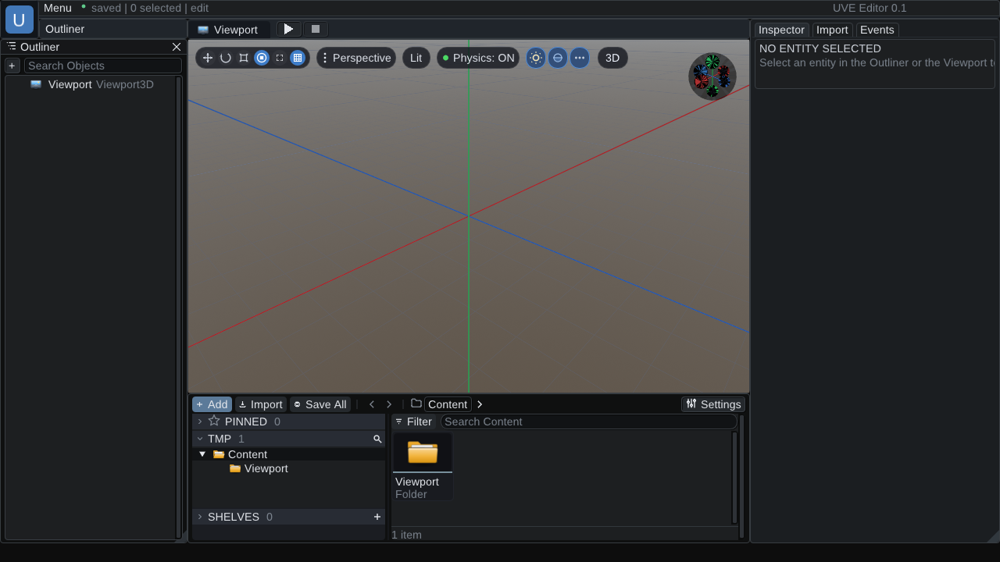

# UniVex_Engine
rebuild 3D and 2D Engine

## Screenshots

The editor running on the OpenGL backend: Outliner, Viewport with the world grid and axes, Content
browser and Inspector. Captured from the live frame buffer of a running editor session.
